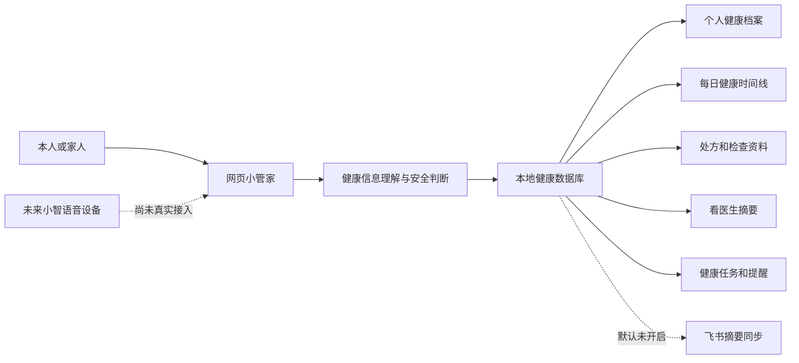
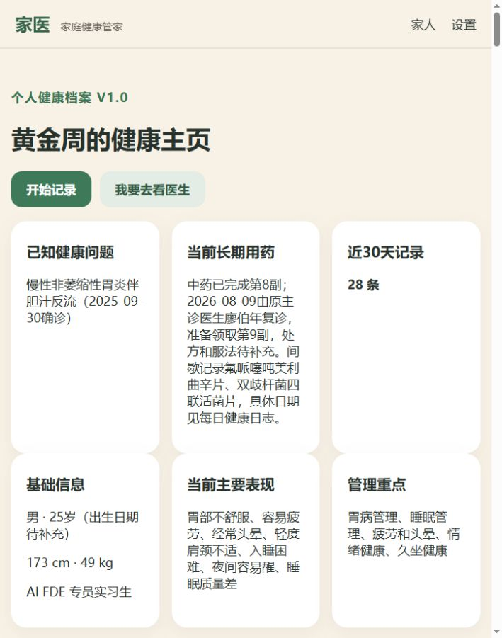
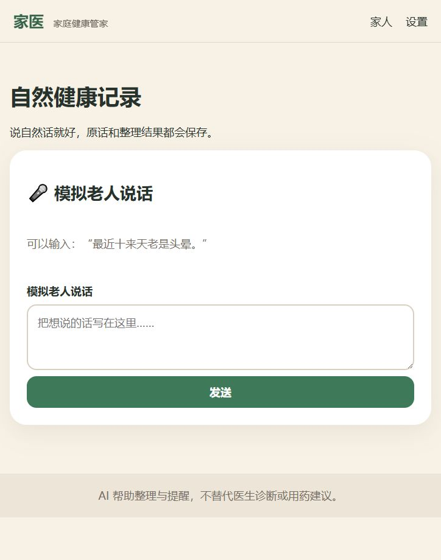
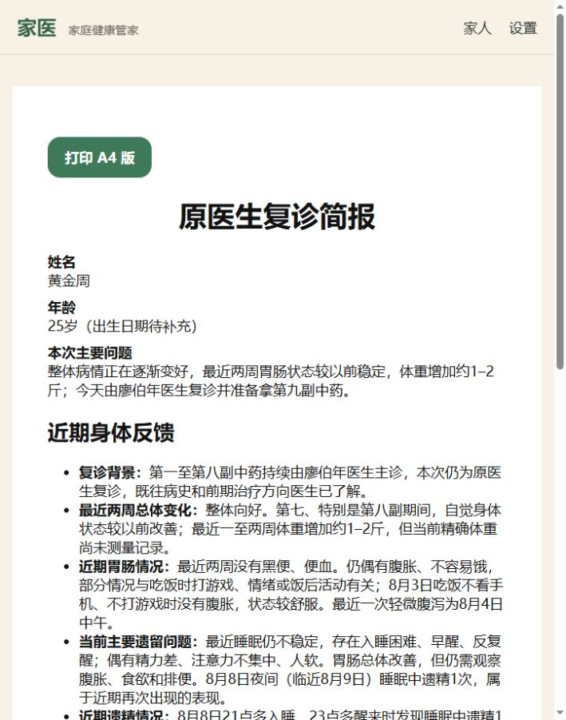
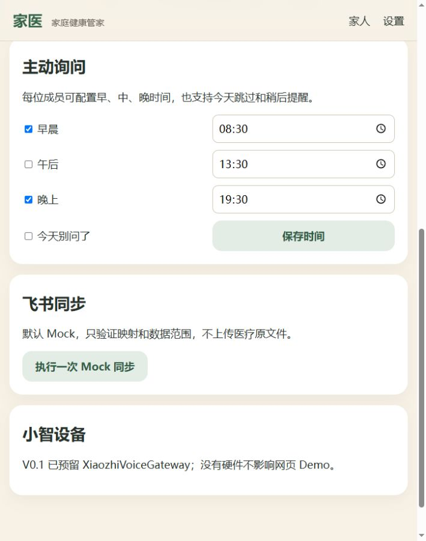
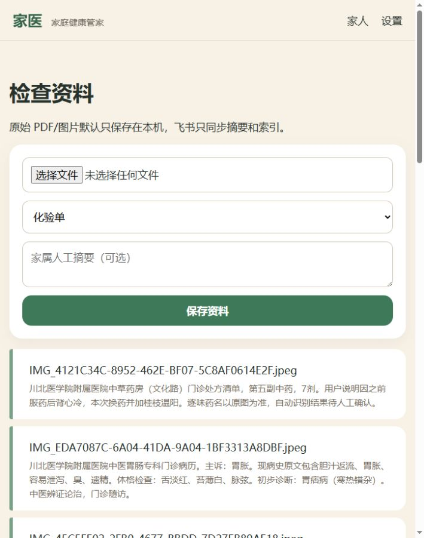

# 智能管家网站与“小智”助手产品复盘

复盘日期：2026-08-09  
项目：FamilyCare AI 家庭健康管家 V0.1  
当前测试用户：黄金周

## 一、结论先说

现在的网站已经不是空壳：个人档案、每日健康日志、检查资料、八副中药及第九副占位、健康时间线、看医生摘要和本地数据库均已真实运行。

但它目前仍是一个“本地健康记录与就医整理原型”，还不是完整的小智语音健康助手：

- 网页中的对话入口现在叫“小管家”，实际输入方式仍是文字。
- “小智设备”目前只有后端语音入口接口，没有连接真实硬件、麦克风、语音识别和语音播报。
- AI 默认使用 Mock（模拟）模式，很多理解能力来自规则和结构化程序，不是已经接通的真实大模型。
- 电话、家属通知、飞书同步、主动询问推送均有流程或接口，但当前不会真实联系外部人员或设备。

当前最合适的产品定位是：

> 让本人或家人用自然语言记录身体变化，由系统长期保存、整理趋势，并在看医生前生成医生容易看懂的摘要。

## 二、产品结构

## 三、当前功能清单

| 功能 | 当前状态 | 已经能做什么 | 现在的边界 |
|---|---|---|---|
| 家庭成员管理 | 真实可用 | 展示黄金周、爸爸、妈妈、爷爷并切换成员 | 首页和设置默认选中爷爷，不符合当前优先测试黄金周的目标 |
| 个人健康档案 | 真实可用 | 保存疾病、身高、体重、职业、用药、管理重点 | 体重仍显示初始49kg，不能自动反映最近增加1–2斤 |
| 小管家文字对话 | 真实可用 | 接收自然语言，保存原话，进行意图分流 | 不是语音；名称与“小智设备”不统一 |
| 每日健康日志 | 真实可用 | 保存症状、睡眠、饮食、运动、情绪及用药反应 | 当前输入页只有大文本框，缺少日期、药物和症状快捷补充入口 |
| 健康信息结构化 | 部分可用 | 能识别部分睡眠、身体不适、饮食、运动、情绪、血压、血糖、体温、体重和遗精表达 | 主要依赖关键词和规则，复杂口语仍可能漏项或误判 |
| 健康时间线 | 真实可用 | 合并日志、测量、处方、就医、任务和检查资料 | 内容过长，无筛选、折叠、搜索和按周/月摘要 |
| 风险提醒 | 部分可用 | 对黑便、便血、剧烈腹痛等关键词标记提醒 | 不能理解否定词，“最近没有黑便、便血”也被误标为风险 |
| 中药疗程管理 | 数据真实存在 | 已保存第1至第8副药，第9副已建立待补充记录 | 网站没有独立的“第几副药”管理页面，用户不容易查看换方和反应对比 |
| 检查资料管理 | 真实可用 | 本地保存图片/PDF并展示人工或已整理摘要 | 默认解析器不是真实OCR；网页不能点击查看原图；逐味中药仍待人工核对 |
| 看医生模式 | 真实可用 | 一次问一个问题；先区分原医生复诊或新医生；生成摘要 | 新建流程仍依赖用户逐题回答，历史信息的自动提炼还需加强 |
| 原医生复诊简报 | 真实可用 | 生成近期精简版、A4打印，已包含趋势、体重、排便、睡眠和遗精 | 当前报告由本次人工校正后质量较好，自动生成稳定性还需继续测试 |
| 新医生详细报告 | 真实可用 | 可包含完整病史、检查、八副用药和症状时间线 | 信息量很大，需要目录、分组和重要程度排序 |
| 就医后记录 | 真实可用 | 保存用户转述的医生意见，并标明信息来源 | 尚未录入本次第九副处方和医生最新反馈 |
| 复查任务 | 真实可用 | 能从“X天/周/月后复查”建立任务 | 网页顶部没有清楚的任务入口，任务完成和修改能力不足 |
| 主动询问 | 部分可用 | 可设置早、中、晚询问时间，支持今天跳过 | 只会在后台计算该问什么，没有真实手机、小智或飞书推送 |
| 联系家人 | 模拟可用 | 识别联系人并进行二次确认 | 当前只返回“模拟拨号成功”，不会真实拨号 |
| 家属通知 | 模拟可用 | 后端要求确认后才执行 | 当前不会发到真实手机或飞书 |
| 飞书同步 | 模拟可用 | 能验证六张表的映射和同步数据范围 | 运行时是Mock；未获得本次授权，不会上传个人医疗数据 |
| 小智设备 | 仅预留接口 | 已有 XiaozhiVoiceGateway，可接收未来设备转来的文字 | 没有真实硬件连接、设备身份验证、语音识别、语音播报和网络安全验证 |
| 真实大模型 | 未启用 | 代码支持配置兼容接口 | 当前健康回答主要是固定规则，不是真实AI推理 |
| OCR/多模态识图 | 未启用 | 代码预留文档识别接口 | 现在不会自动可靠读取新处方，仍需人工审核图片 |
| Android手机端 | 基础骨架 | 已有伴侣端基础工程 | 默认模拟模式，未形成可以直接安装使用的正式App |
| 家庭视频 | 未实现 | 预留接口 | 当前不能视频联系家人，也不会自动操作微信 |

## 四、主要页面流程和证据

### 步骤1：首页与家庭入口——基本健康，但默认成员错误

优点：老人能看见“我要去看医生”“联系家人”等大按钮；文字尺寸和触摸区域较大。  
问题：首页默认选中爷爷，当前真实测试用户是黄金周；首页称“小管家”，设置页又称“小智设备”，产品身份不统一。

### 步骤2：个人档案与时间线——数据完整，但阅读负担很大

优点：疾病、用药、基础信息、管理重点和历史日志已真实展示。  
问题：时间线把所有内容全部展开；没有“最近7天、用药、排便、睡眠、检查资料”等筛选；否定句被风险规则误报。

### 步骤3：每日记录与小管家——入口简单，但仍是文字模拟

优点：输入门槛低，原话可以直接保存。  
问题：标题仍写“模拟老人说话”，不适合黄金周本人使用；没有真正录音按钮；输入后看不到“系统提取出了哪些字段”的确认卡片。

### 步骤4：看医生模式——流程清楚，仍需增强自动提炼

优点：一次只问一件事，适合老人；已加入原医生与新医生分流。  
问题：页面没有先展示“系统已经知道什么”，用户无法快速发现AI有没有漏掉遗精、体重变化等内容。

### 步骤5：医生复诊简报——当前最接近正式产品的功能

优点：能打印、结构清楚、适合复诊；当前已正确区分历史问题和最近两周情况。  
问题：报告生成后缺少“确认无误/修改一项/标记已给医生看”的按钮。

### 步骤6：设置与主动询问——配置存在，但不会真正推送

### 步骤7：飞书与小智状态——边界写得诚实

优点：页面已经明确标注Mock和预留接口，没有假装真实联网。  
问题：普通用户不理解Mock、API Key、XiaozhiVoiceGateway等技术词，应该改成“模拟模式、真实AI未连接、小智设备未连接”。

### 步骤8：检查资料管理——资料真实存在，但缺少查看和分类能力

优点：原始医疗文件保存在本机，摘要和原图分开，隐私方向正确。  
问题：列表用文件名做标题，用户难以辨认；不能点击原图；没有按“胃镜、血常规、中药处方、门诊病历”筛选；文件选择按钮仍显示英文。

## 五、当前最重要的产品问题

### P0：必须先解决

1. **默认成员错误**：黄金周是当前主测试用户，但首页和设置默认选择爷爷，可能把新记录写错人。
2. **风险提醒误判否定句**：“没有黑便、没有便血”不应被标记为正在出现危险症状。
3. **小智身份不统一**：小管家、小智设备、模拟老人说话三种叫法混用。
4. **关键功能入口缺失**：检查资料、健康任务、中药疗程没有出现在主导航。
5. **第九副药闭环未完成**：处方图片、剂数、服法、医生原话和复诊时间仍待录入。

### P1：下一阶段重点

1. 增加“最近7天健康摘要”：胃肠、排便、睡眠、体重、情绪、遗精、用药变化。
2. 时间线增加筛选、折叠、关键词搜索和“只看异常”。
3. 增加中药疗程页：第1至第9副、换方关系、开始结束日期、每日反应和总体趋势。
4. 检查资料增加中文标题、原图预览、资料类型筛选和医生确认状态。
5. 报告生成前展示核对清单，用户确认后再形成正式报告。
6. 增加记录纠错功能；删除仍必须二次确认并保留审计记录。
7. 更新旧验收文档：`acceptance-v0.1.md`仍写16项测试和数据库迁移0001，当前实际为22项测试、迁移0003，避免后续误判项目状态。

### P2：网站稳定后再接

1. 接入真实大模型并进行医疗安全测试。
2. 接入真实小智语音设备：唤醒、语音识别、身份绑定、语音播报。
3. 接入真实手机通知或小智主动询问。
4. 经用户单次明确授权后，再测试飞书摘要同步。
5. 增加账号、家庭权限、备份、加密和设备丢失处理。

## 六、可用性与无障碍观察

已确认的优点：

- 正文字号约17至18px，主要按钮高度不低于52px，适合触摸。
- 页面使用标题、表单标签和按钮语义，基本阅读顺序清楚。
- 危险提醒不仅使用颜色，还包含文字说明。

可见风险：

- 成员选择按钮没有向辅助技术说明“当前选中谁”。
- 样式中没有明确的键盘焦点状态，键盘用户可能看不出光标位置。
- 部分图标使用表情符号，不同设备显示可能不一致。
- 超长时间线对老人、低视力用户和屏幕阅读器负担很大。
- 文件选择控件显示英文，中文用户不容易理解。

证据边界：本次根据实际页面截图和页面结构完成审查，没有使用屏幕阅读器逐项测试，也不能据此宣称已经完全符合无障碍标准。

## 七、需要黄金周确认的产品决定

推荐默认采用以下选择：

1. 网站助手统一命名为“**小智健康管家**”，不再混用“小管家”和“模拟老人说话”。
2. 登录或打开网站后默认进入“**黄金周本人**”，家庭成员通过“切换家人”进入。
3. 下一阶段先把网页端的记录、趋势、处方、报告做稳定，再连接真实小智硬件。
4. 个人健康资料继续只保存在本机；飞书和外部AI都必须单独授权后才能发送。
5. 首页优先显示四个入口：今天记录、健康趋势、中药疗程、准备看医生。

如果上述五项没有异议，可以直接作为V0.2产品规则。

## 八、建议的下一步实施顺序

第一轮只做四件事：

1. 修正默认成员为黄金周，并记住上次选择。
2. 修复“没有黑便/没有便血”的误报警。
3. 统一“小智健康管家”名称，并把技术词换成普通中文。
4. 给首页增加“检查资料、健康任务、中药疗程”入口。

完成后再做第二轮：最近7天摘要、时间线筛选、中药疗程对比、资料原图预览和报告确认。

## 九、当前验收状态

- 本地网页：可打开。
- 本地后端：可运行。
- 自动测试：24项通过；前端生产构建通过。
- 黄金周真实资料：已保存于本地。
- 当前复诊简报：可打开并打印。
- 小智真实语音：未接入。
- 真实大模型：未启用。
- 真实电话和家属推送：未启用。
- 飞书真实同步：本次未执行。
- 本次复盘：只读取和截图，没有删除任何文件。

## 十、第一轮修改完成记录（2026-08-09）

本轮已按推荐方案完成并验收：

1. 首页默认进入黄金周，切换成员后会在本机记住上次选择；成员按钮已补充选中状态说明。
2. 修复风险提醒对否定句的误判：“最近没有黑便、便血”“没有黑便、没有便血”不再触发风险；如果后文明确写“但是今天出现黑便”，仍会触发提醒。
3. 已重新核对黄金周历史日志：仅修正一条否定句误报警；2026年6月12日真实记录的黑便仍保留风险标记。
4. 网站助手统一命名为“小智健康管家”，设置页的技术词改为普通中文，并明确真实AI、设备推送和飞书上传均未接入。
5. 首页整理为四个核心入口：今天记录、健康趋势、中药疗程、准备看医生；检查资料、健康任务、联系家人作为辅助入口。
6. 新增中药疗程页，展示第1至第9副药；第9副药目前明确显示“等待补充处方”。
7. 增加键盘焦点样式，方便键盘操作时识别当前位置。

验收结果：后端与规则测试共24项全部通过，前端生产构建通过；本轮没有删除任何文件。

## 十一、第二轮修改完成记录（2026-08-11）

本轮继续按推荐方案完成以下闭环：

1. 看医生关系已结构化保存为“原医生复诊 / 新医生初诊 / 待确认”，先判断否定表达，避免“不是原医生”被关键词误判为复诊；廖伯年医生复诊会生成近期精简版。
2. 就医报告生成前可逐项修改核对内容；正式报告可标记“已给医生看”，随后再补录医生意见与第九副处方。
3. “最近没有黑便、便血”不会被标成风险；“之前没有，但今天出现黑便”仍会提醒，二者均有自动测试。
4. 小智对话会展示已提取字段，并允许直接修改刚才的原始健康记录，系统重新解析并更新风险状态。
5. 7天/14天摘要按睡眠、胃肠、精力、体重、情绪、口腔、遗精和用药变化分别截取相关短句，避免同一篇长日志在多个主题中整段重复。
6. 时间线增加关键词搜索、分类、7天/30天、只看异常、按日期折叠和每次25条分批显示。
7. 历史检查资料根据已有人工摘要补充有效分类和中文标题，不修改或删除原文件；图片可在网页预览原图。
8. 健康任务分为待完成和已完成，可标记完成或恢复为待办。
9. README 和验收文档已按当前真实状态更新。

验收结果：后端37项测试全部通过，前端生产构建通过；没有删除任何文件，也没有向飞书或外部AI上传个人医疗数据。
